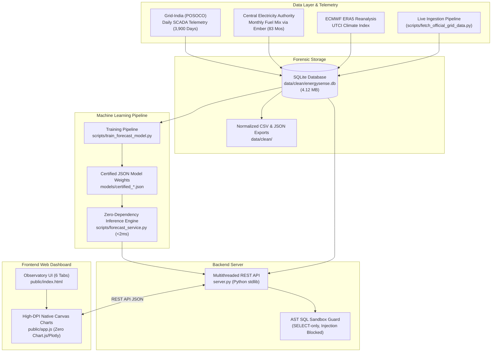

<div align="center">

# ⚡ EnergySense India
### National Power System Analytics Observatory & Machine Learning Forecasting Engine

[](https://www.python.org/)
[](https://docs.python.org/3/library/)
[-003B57?logo=sqlite&logoColor=white)](https://www.sqlite.org/)
[-E34F26?logo=html5&logoColor=white)](public/index.html)
[](LICENSE)
[](tests/)

*An authoritative, high-performance platform synthesizing 11 years of Indian electricity grid telemetry, institutional fuel generation accounting, and leakage-safe machine learning forecasting.*

[Features](#-key-features) • [Data Forensic Audits](#-forensic-data-hygiene--audited-discoveries) • [Forecasting Benchmarks](#-machine-learning-forecasting-engine) • [Architecture](#-high-level-system-architecture) • [Quick Start](#-quick-start-run-in-30-seconds) • [Documentation](#-flagship-technical-documentation)

---

</div>

## 📌 Executive Overview

**EnergySense India** addresses the deep fragmentation of power system data across Indian statutory institutions:
- **Grid-India (formerly POSOCO)**: Publishes high-frequency operational SCADA telemetry (Daily Power Supply Position reports) reflecting physical grid frequency and instantaneous dispatch.
- **Central Electricity Authority (CEA)**: Compiles monthly post-facto statutory fuel generation accounts and capacity statistics.
- **ECMWF ERA5 Reanalysis**: Provides high-resolution Universal Thermal Climate Index (UTCI) temperature data.

Raw operational reports contain OCR artifacts, calendar gaps, and negative deficit anomalies. EnergySense normalizes, forensically audits, and models these streams into a **zero-external-dependency**, high-throughput research observatory and API engine.

```
+-----------------------------------------------------------------------------------------+
|                                    ENERGY SENSE AT A GLANCE                             |
+-----------------------------------------------------------------------------------------+
|  Historical Telemetry  |  3,900 All-India daily records (2013-01-01 to 2024-04-28)      |
|  State Telemetry       |  32,072 state-day observations across 37 States & UTs          |
|  Decarbonization       |  83 consecutive months of fuel mix generation (2019-2025)      |
|  Forecasting Accuracy  |  1.45% MAPE on Day-1 Energy Met (+29.1% vs Persistence)        |
|  Inference Latency     |  < 2 ms via pure Python standard library vector math           |
|  Backend Stack         |  Standard Python socketserver + SQLite (zero heavy frameworks) |
+-----------------------------------------------------------------------------------------+
```

---

## 🔬 Forensic Data Hygiene & Audited Discoveries

Unlike typical textbook datasets, real grid telemetry contains severe reporting anomalies. EnergySense identified and mathematically resolved three major data invariants:

### 1. The 236 Missing Calendar Days & Debunking the False 8.27% CAGR
* **The Anomaly**: Between `2013-01-01` and `2024-04-28` (4,136 calendar days), only 3,900 observations exist—revealing **236 missing days across 93 gap clusters**. This includes an **82-day continuous outage in early 2013** (Jan 8 – Mar 30, 2013), leaving only 271 recorded days in 2013 ($716,800\text{ MU}$).
* **The Correction**: Comparing unadjusted annual sums between 2013 and 2023 falsely inflated 10-year demand growth to **8.27%**. By calculating normalized mean daily demand ($2,645.0\text{ MU/day}$ in 2013 vs $4,358.2\text{ MU/day}$ in 2023), EnergySense established the true, audited annualized CAGR of **5.12%**.

### 2. Six Negative Peak Deficit Anomalies
* Raw scraped files contained 6 negative peak unmet records (`peak_unmet_mw` down to $-3,171\text{ MW}$ on 2014-07-23). Under physical grid definitions, curtailment deficit cannot be negative.
* **Resolution**: Raw accounting values are preserved in SQLite with an explicit forensic audit flag (`is_negative_unmet = 1`), while the visual charting engine safely clamps the curve to $0\text{ MW}$ with an audit note.

### 3. Thermal Climate Series Truncation
* ECMWF ERA5 UTCI reanalysis ends on `2020-12-31`, leaving 1,196 dates with null climate data.
* Bivariate OLS proved that national-aggregate temperature has near-zero linear correlation with national demand ($r = 0.059, R^2 = 0.0035$), proving that naive nationwide weather cannot drive dispatch models without regional cooling-degree-day (CDD) disaggregation.

---

## 🤖 Machine Learning Forecasting Engine

EnergySense forecasts short-term national demand trajectory across two primary targets:
1. **Daily Energy Met (`energy_met_mu`)**: Total electricity volume supplied over 24 hours (Million Units = GWh).
2. **Daily Peak Power Met (`peak_met_mw`)**: Maximum simultaneous power demand served (MW).

### Leakage-Free Chronological Split
Randomized K-fold splits in time series leak future information. EnergySense enforces strict chronological isolation:
* **Training Set (2013–2021)**: 3,052 days of historical grid evolution.
* **Validation Set (2022)**: 365 days (model architecture and hyperparameter $\alpha=0.01$ frozen exclusively here).
* **Holdout Test Set (2023-01-01 to 2024-04-28)**: 483 days of unseen future ground truth.

### Holdout Benchmark Results (442 Common Forecast Origins)

Evaluated across the exact same 442 common holdout origins ($D+1 \dots D+7$):

| Horizon | Target Date | Origin Persistence ($y_D$) | Seasonal-Naive ($y_{D+h-7}$) | Direct Ridge ($M_h$) | Ridge MAPE | vs Persistence | vs Seasonal-Naive |
| :---: | :---: | :---: | :---: | :---: | :---: | :---: | :---: |
| **Day 1** | $D+1$ | 89.36 MU (2.07%) | 176.91 MU (4.10%) | **63.36 MU** | **1.45%** | **+29.10%** | **+64.19%** |
| **Day 2** | $D+2$ | 132.95 MU (3.08%) | 176.56 MU (4.09%) | **105.59 MU** | **2.42%** | **+20.57%** | **+40.19%** |
| **Day 3** | $D+3$ | 155.87 MU (3.61%) | 176.64 MU (4.09%) | **129.71 MU** | **2.98%** | **+16.78%** | **+26.57%** |
| **Day 4** | $D+4$ | 168.89 MU (3.91%) | 177.08 MU (4.10%) | **148.84 MU** | **3.41%** | **+11.87%** | **+15.94%** |
| **Day 5** | $D+5$ | 177.24 MU (4.10%) | 176.71 MU (4.09%) | **163.83 MU** | **3.74%** | **+7.57%** | **+7.29%** |
| **Day 6** | $D+6$ | 176.31 MU (4.07%) | 176.49 MU (4.08%) | **175.22 MU** | **3.98%** | **+0.62%** | **+0.72%** |
| **Day 7** | $D+7$ | 176.27 MU (4.07%) | **176.27 MU** (4.07%) | 182.25 MU | 4.13% | -3.39% | -3.39% |

> **Production Deployment Note**: Day 1–5 predictions deploy certified Ridge regression weights. For Day 7, the system automatically transitions to Seasonal-Naive ($y_{D+h-7}$) where weekly periodicity matches or outperforms autoregression.

### Zero-Dependency Inference Engine
Model weights, intercepts, feature means, and scaling factors are serialized to pure JSON ([`models/`](models/)). Inference executes via pure standard library vector dot-products in [`scripts/forecast_service.py`](scripts/forecast_service.py) with **$<2\text{ ms}$ latency**, completely removing Scikit-learn, PyTorch, or NumPy runtime requirements.

---

## 🏛️ High-Level System Architecture



---

## 💻 Interactive UI Walkthrough (6 Analytical Tabs)

1. **National Demand & Peak Load (2013–2024)**: Visualizes 11 years of daily demand trajectory, 7-day moving averages, seasonal summer surges, COVID-19 lockdown drop (-24.0%), and peak load records (249,623 MW).
2. **AI Forecasting Engine (1–7 Days)**: Origin date picker (`2013-01-01` to `2024-04-28`), horizon selector ($1 \dots 7$), 90% confidence uncertainty bands, Day-1 persistence comparisons, and retrospective backtest residual error tracking.
3. **Climate & Heatwave Elasticity**: Dual-axis canvas plotting UTCI thermal index (°C) against power demand, alongside an interactive cooling sensitivity slider.
4. **Generation Fuel Mix & Decarbonization (2019–2025)**: Stacked generation area chart across 7 fuels (Coal, Solar, Wind, Hydro, Nuclear, Gas, Bioenergy), clean share tracking (peaking at 35.74%), and grid carbon intensity ($g\text{CO}_2/\text{kWh}$).
5. **State Matrix & Leaderboards**: Deep dive into 36 individual States/UTs (11-year demand curves, capacity mix) with side-by-side head-to-head state comparisons.
6. **Interactive SQL Sandbox & Exports**: Live read-only SQL editor allowing custom SQLite queries, preloaded analytical presets, and direct CSV/JSON data downloads.

---

## ⚡ Quick Start (Run in 30 Seconds)

### Prerequisites
* **Python 3.12+**
* **Zero package installation required** for the server, inference, and dashboard.

### 1. Clone & Start Locally
```bash
# Clone the repository
git clone https://github.com/hemanth-sai-2203/energySense.git
cd energySense

# Start the multithreaded server
python server.py
```
Open your browser and navigate to: **`http://localhost:8000`**

### 2. Run the Automated Test Suite
```bash
python -m unittest discover -s tests -p "test_*.py"
```

### 3. Test Live Data Ingestion
```bash
# Dry-run 7 days of post-April 2024 telemetry:
python scripts/fetch_official_grid_data.py --source offline_benchmark --days 7 --dry-run
```

### 4. Run via Docker
```bash
docker build -t energysense .
docker run -p 8000:8000 energysense
```

---

## 📁 Repository Structure

```text
energySense/
├── .github/workflows/ci.yml           # Automated CI test pipeline
├── data/
│   ├── clean/                         # Audited production database and mirrors
│   │   ├── energysense.db             # Normalized SQLite DB (4.12 MB, indexed)
│   │   ├── daily_demand_india.csv     # 3,900 All-India daily records (2013-2024)
│   │   ├── monthly_generation_india.csv# 83 monthly fuel mix records (2019-2025)
│   │   ├── state_daily_demand.csv     # 32,072 state-day records (2022-2024)
│   │   └── state_annual_summary.csv   # 456 state-year summaries
│   └── raw/                           # Scraped and source archive CSVs
├── docs/                              # In-depth technical documentation
│   ├── complete_project_master_guide.md # Comprehensive engineering master guide
│   ├── architecture_and_feasibility_review.md # Initial technical audit & feasibility
│   ├── forecast_protocol_audit.md     # Multi-horizon leakage verification
│   ├── model_evaluation_report.md     # Holdout benchmark reproduction report
│   └── data_provenance_and_governance.md # Statutory jurisdictions (CERC/CEA/POSOCO)
├── models/                            # Certified Ridge model artifacts (pure JSON)
│   ├── certified_energy_model.json    # Energy Met weights, scalers, and residuals
│   └── certified_peak_model.json      # Peak Load weights, scalers, and residuals
├── public/                            # Lightweight Web Dashboard
│   ├── index.html                     # Semantic HTML5 dashboard with 6 tabs & modals
│   ├── styles.css                     # Responsive research observatory design system
│   └── app.js                         # 60fps native HTML5 Canvas charting engine
├── scripts/                           # Pipelines, inference, and CLI utilities
│   ├── forecast_service.py            # Zero-dependency vector inference engine (<2ms)
│   ├── fetch_official_grid_data.py    # Multi-source post-freeze grid ingestion CLI
│   ├── verify_forecast_protocol.py    # Holdout benchmark verification runner
│   ├── train_forecast_model.py        # Ridge training & JSON exporter
│   └── audit_datasets.py              # Forensic gap and anomaly analyzer
├── tests/                             # Automated test suite (46 regression tests)
│   ├── test_data_invariants.py        # Calendar gaps, nulls, negative values
│   ├── test_forecasting.py            # Leak-free split & baseline superiority
│   ├── test_server_endpoints.py       # API query contracts & AST SQL filtering
│   └── test_grid_ingestion.py         # CLI arguments and schema compliance
├── Dockerfile                         # Production container definition
├── server.py                          # Multithreaded Python HTTP/REST API server
└── requirements.txt                   # Optional scientific dependencies for retraining
```

---

## 📚 Flagship Technical Documentation

For deeper domain analysis and implementation specifications, see the documentation in [`docs/`](docs/):

* 📘 [**Complete Project Master Guide**](docs/complete_project_master_guide.md) — Comprehensive technical reference, database schemas, and end-to-end walkthrough.
* ⚖️ [**Data Provenance & Institutional Governance**](docs/data_provenance_and_governance.md) — SCADA vs Regional Energy Accounting (REA), statutory roles of MoP, CERC, CEA, and Grid-India.
* 📊 [**Forecasting Protocol & Leakage Audit**](docs/forecast_protocol_audit.md) — Origin-aligned direct horizon formulations and common holdout date accounting.
* 📈 [**Model Evaluation Report**](docs/model_evaluation_report.md) — Baseline reproduction, error distributions, and Ridge hyperparameter tuning.

---

## 📄 License

This project is licensed under the MIT License — see the [LICENSE](LICENSE) file for details.

