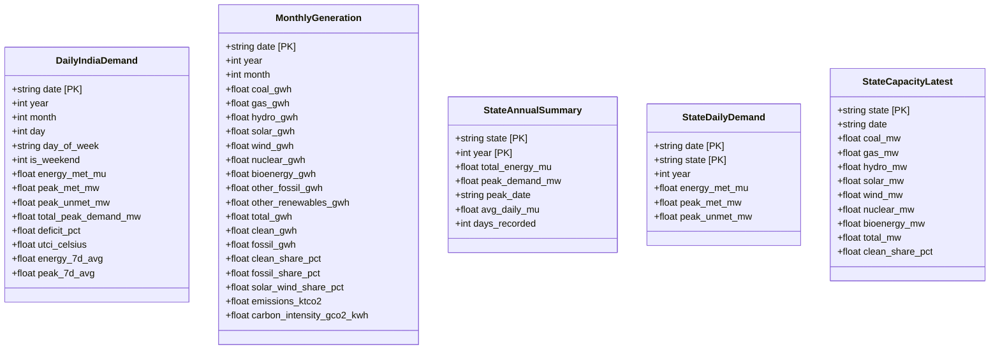
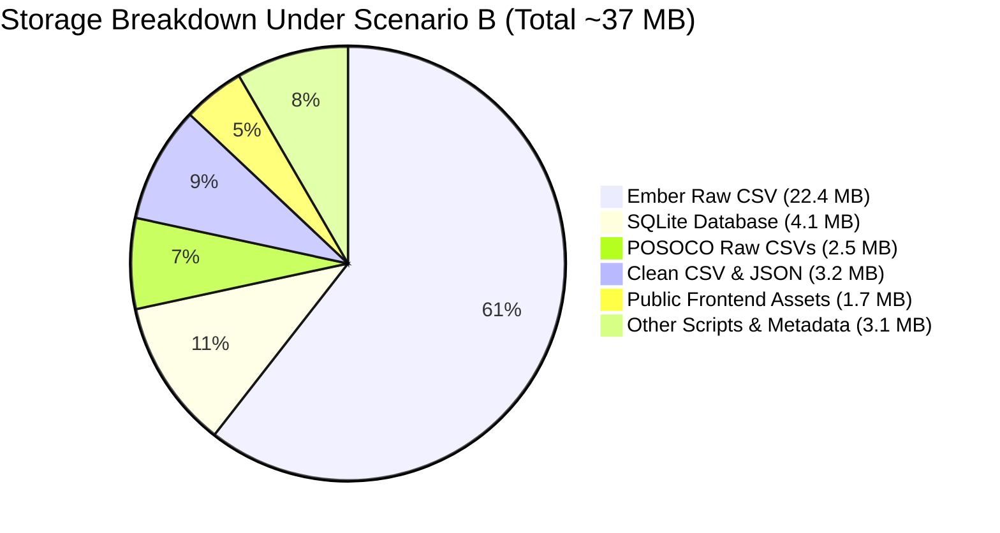
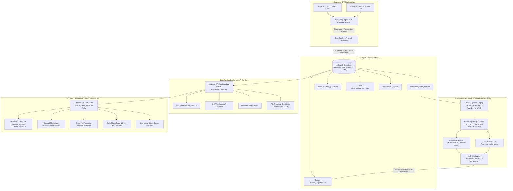
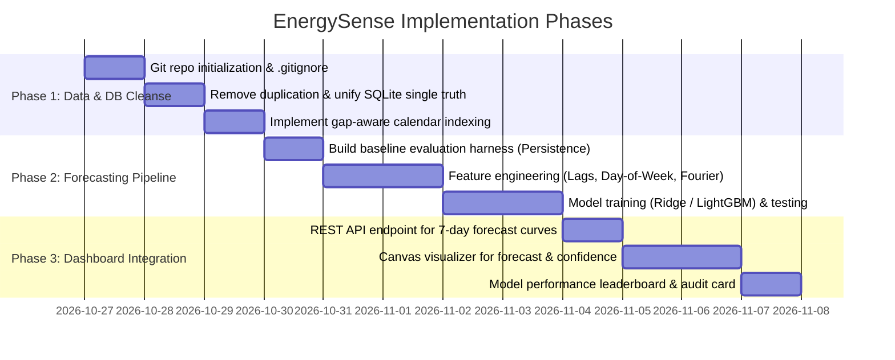

# EnergySense / GridSense: Technical Architecture, Data Audit & Feasibility Review

**Document Version:** 1.0.0  
**Status:** Audit Complete — Pending Architectural Approval  
**Auditor:** Senior Data Engineer, Applied Time-Series Scientist & Pragmatic Software Architect  
**Date:** October 26, 2026  

---

## Executive Summary

This document presents a rigorous technical audit of the **EnergySense** codebase, its underlying Indian power system datasets, the empirical claims presented in `energy_sense_observatory_report.md`, and proposes an implementation plan for **EnergySense / GridSense**.

### Key Audit Verdict
1. **Repository & Implementation Reality:** The repository contains a functional prototype with raw ingestion scripts (`scripts/extract_raw_data.py`, `scripts/build_clean_dataset.py`), a multithreaded Python SQLite API server (`server.py`), and a frontend (`public/index.html`, `styles.css`, `app.js`). However, Git tracking is uninitialized (no initial commit), dependencies are unpinned, and data files are duplicated across multiple directories.
2. **Data Integrity Findings:** 
   - The daily national demand series covers **3,900 observations** from **2013-01-01 to 2024-04-28**.
   - **Crucial Discovery:** The dataset is **not consecutive daily**. There are **236 missing days across 93 gap clusters**, including an **82-day continuous gap in early 2013** (Jan 8 – Mar 30, 2013) and a **50-day cumulative gap in 2020**.
   - **Thermal Climate Index (UTCI) Gap:** The daily climate series ends abruptly on **2020-12-31**. Consequently, **1,196 rows (30.7%) of the daily demand series (2021–2024) have null weather values**.
   - **Negative Values:** The raw peak unmet deficit (`peak_unmet_mw`) contains **6 negative values** (down to -3,171 MW), which are physical impossibilities under standard deficit definitions.
3. **Challenging Report Claims:**
   - **Debunked 8.27% CAGR Claim:** The report's claim of an **8.27% 10-year demand CAGR** is mathematically distorted by missing data. In 2013, only 271 days were recorded (716,800 MU), compared to 364 days in 2023 (1,586,383 MU). Comparing unadjusted annual sums artificially inflated the CAGR by over 3 percentage points. **The true annualized CAGR (comparing mean daily demand: 2,645.0 MU/day in 2013 vs 4,358.2 MU/day in 2023) is 5.12%**.
   - **Thermal Sensitivity Correlation:** The reported "heat sensitivity of 199.7 MW/°C" has an empirical Pearson correlation of **$r = 0.059$ ($R^2 < 0.004$)** across the 2013–2020 merged window. The reported OLS slope is confounded by India's secular ~5% annual economic demand growth and seasonal baselines without proper time-series detrending.
4. **Feasibility & Recommended Forecasting Scope:** 
   - A single-node machine learning forecasting engine for **National Daily Electricity Energy Met (`energy_met_mu` in MU)** and **Daily Peak Met (`peak_met_mw` in MW)** is feasible.
   - Using a strict chronological split (Train: 2013–2022 [3,417 days], Test: 2023–2024 [483 days]), the naive Day-1 Persistence baseline achieves **MAE = 89.9 MU (2.08% MAPE)**, while Seasonal Naive ($t-7$) achieves **MAE = 182.1 MU (4.22% MAPE)**. 
   - Any machine learning model (e.g. Ridge Regression, LightGBM) must beat this **89.9 MU (2.08%) baseline** on the 2023–2024 test set to justify deployment.

---

## 1. Repository & Codebase Audit

### 1.1 Git Status & Version Control
- **Branch:** `master`
- **Commit History:** Zero commits (`No commits yet`). The repository has been initialized with `git init` but all 51 files are untracked.
- **Untracked Directories:** `__pycache__/`, `data/`, `public/`, `scripts/`, `server.py`.
- **Verdict:** [Verified] Critical operational risk. No version history exists. Immediate priority must be adding `.gitignore` (excluding `__pycache__` and large raw downloads) and establishing an initial clean commit.

### 1.2 Environment & Dependencies
- **Python Version:** 3.12.2 (Standard Library only: `csv`, `json`, `sqlite3`, `socketserver`, `http.server`, `urllib`, `datetime`, `math`, `collections`).
- **External Packages:** `pip list` confirms only `pip 24.0`, `setuptools 80.9.0`, and `wheel 0.45.1`. Neither `pandas`, `numpy`, `scipy`, `scikit-learn`, nor `lightgbm` are currently installed.
- **Node.js:** Not installed in the host OS environment.
- **Verdict:** [Verified] The pipeline runs on zero external dependencies using the Python standard library. Future ML forecasting will require a minimal, explicit `requirements.txt` (`numpy`, `pandas`, `scikit-learn`, `joblib`).

### 1.3 File Inventory & Size Breakdown

| Component | Path | Measured Size | Status / Functionality |
| :--- | :--- | :--- | :--- |
| **Backend API** | `server.py` | 8.39 KB | **Functional**: `ThreadingTCPServer` with REST endpoints (`/api/analytics`, `/api/daily`, `/api/generation`, `/api/states`, `/api/capacity`, `/api/download`) and restricted SELECT SQL runner. |
| **ETL Extractor** | `scripts/extract_raw_data.py` | 2.34 KB | **Functional**: Extracts CSVs from system step files into `data/raw/`. |
| **Data Builder** | `scripts/build_clean_dataset.py` | 24.34 KB | **Functional**: Merges UTCI, POSOCO demand, and Ember generation into SQLite DB and clean CSV/JSON. |
| **Raw Datasets** | `data/raw/` (9 files) | 39.46 MB | **Present**: Ember monthly (22.39 MB), POSOCO daily CSVs (~2.5 MB), 4 state CSVs (14.2 MB), UTCI climate (440 KB). |
| **Clean Datasets** | `data/clean/` (10 files) | 7.27 MB | **Present**: SQLite DB (4.06 MB), daily demand CSV/JSON (1.77 MB), state daily (1.36 MB), monthly generation (58 KB), state annuals (115 KB). |
| **Public Mirror** | `public/data/` (5 files) | 1.58 MB | **Duplicate**: Redundant copy of clean JSON files for static client-side fallback. |
| **Frontend UI** | `public/index.html` | 37.10 KB | **Functional**: Semantic HTML5 dashboard with 6 KPI cards, 6 tabs, canvas wrappers, and SQL sandbox. |
| **Styles** | `public/styles.css` | 29.79 KB | **Functional**: Modern glassmorphic dark theme, responsive CSS Grid/Flexbox, micro-animations. |
| **Client Engine** | `public/app.js` | 36.56 KB | **Functional**: Native HTML5 Canvas charting, multi-tab switching, client-side SQL fallback query engine. |

Total workspace size is **48.49 MB across 51 files**.

---

## 2. Comprehensive Data Audit



### 2.1 Dataset-by-Dataset Verification

#### Dataset 1: All-India Daily Electricity Demand & Peak Deficit
- **Path:** `data/clean/daily_demand_india.csv` (and table `daily_india_demand` in SQLite)
- **Source:** POSOCO / Grid-India daily reports compiled via Zenodo (DOI: 10.5281/zenodo.14983362).
- **License:** Creative Commons Attribution 4.0 International (CC-BY 4.0).
- **Disk Size:** 341.2 KB (CSV), 1.43 MB (JSON).
- **Row Count:** 3,900 rows; **Column Count:** 14 columns.
- **Earliest / Latest Observation:** `2013-01-01` to `2024-04-28`.
- **Nominal Frequency:** Daily.
- **Actual Usable Observations & Continuity Audit:**
  - Expected calendar days in interval: **4,136 days**.
  - Actual unique dates present: **3,900 days**.
  - **Missing Days: 236 days (5.7% of timeline)** across **93 distinct gap clusters**.
  - Major gaps:
    1. `2013-01-08` to `2013-03-30`: **82 consecutive days missing**.
    2. `2020-09-17` to `2020-09-23`: **7 consecutive days missing**.
    3. `2017-02-11` to `2017-02-19`: **9 consecutive days missing**.
    4. `2014-01-01` to `2014-01-07`: **7 consecutive days missing**.
- **Target Variable Semantics:**
  - `energy_met_mu`: Total energy actually supplied/drawn across India during the 24-hour cycle in Million Units (1 MU = 1 GWh = $10^6$ kWh). Min: 2,218.7 MU, Max: 5,224.3 MU, Mean: 3,469.3 MU.
  - `peak_met_mw`: Maximum simultaneous met power load during the day in Megawatts (MW). Min: 104,283.4 MW, Max: 249,623.0 MW, Mean: 168,087.4 MW.
  - `peak_unmet_mw`: Peak power deficit/curtailment in MW. Min: **-3,171.0 MW (Anomaly)**, Max: 12,251.0 MW, Mean: 1,962.6 MW.
  - **Semantic Distinction:** Energy Met is *constrained supply*, not unrestricted consumer demand. When grid deficits were high (2013–2015), actual unconstrained demand exceeded met supply by up to 12.2 GW.
- **Null Percentage:** 0.0% for all power columns. **30.67% null (1,196 rows)** for `utci_celsius` (completely absent from 2021-01-01 onward).
- **Classification:** [Verified] with [Identified Gaps].

#### Dataset 2: Monthly Electricity Generation & Emissions (Ember)
- **Path:** `data/clean/monthly_generation_india.csv` (and table `monthly_generation` in SQLite)
- **Source:** Ember Climate Global Electricity Review / India Monthly Release.
- **License:** Creative Commons Attribution-ShareAlike 4.0 (CC-BY-SA 4.0).
- **Disk Size:** 11.05 KB (CSV), 46.80 KB (JSON).
- **Row Count:** 83 monthly rows; **Column Count:** 20 columns.
- **Earliest / Latest Observation:** `2019-01-01` to `2025-11-01`.
- **Frequency:** Monthly.
- **Structure:** 83 observations representing the national aggregate generation breakdown by 7 fuel sources (Coal, Gas, Hydro, Solar, Wind, Nuclear, Bioenergy), clean vs fossil shares, total emissions (`emissions_ktco2`), and grid carbon intensity (`carbon_intensity_gco2_kwh`).
- **Missing Dates / Duplicates:** 0 duplicates, 83 consecutive months without gaps.
- **Null Percentage:** 0.0% across all 20 columns.
- **Classification:** [Verified].

#### Dataset 3: State-Level Annual Aggregations & Daily Load
- **Paths:** `data/clean/state_annual_summary.csv` (456 rows) and `data/clean/state_daily_demand.csv` (32,072 rows).
- **Entities Covered:** 38 distinct entities:
  - 28 States and 8 Union Territories of India.
  - 2 non-state regional utility entities: `AMNSIL` (industrial captive network) and `Damodar Valley Corporation` (DVC).
- **Annual Matrix Audit:**
  - 38 entities $\times$ 12 years (2013–2024) = **456 state-years** [Verified].
  - `peak_date` has 29 nulls (6.36%) where newly formed states (e.g. Telangana prior to June 2014 split) or island territories had zero recorded met demand.
- **Recent Daily State Matrix Audit:**
  - Covers 2022-01-01 to 2024-04-28: 844 unique dates $\times$ 38 entities = **32,072 records** [Verified].
- **Classification:** [Verified].

#### Dataset 4: State-Level Installed Capacity Snapshot
- **Path:** `data/clean/state_capacity_latest.json` (and table `state_capacity_latest` in SQLite).
- **Entities Covered:** 37 states/UTs (excluding AMNSIL, DVC, and Lakshadweep where utility-scale generation reporting is consolidated into central figures).
- **Classification:** [Verified].

### 2.2 SQLite Database Audit & Storage Deduplication
- **File:** `data/clean/energysense.db`
- **File Size:** **4.06 MB**
- **Schema & Table Audit:**
  1. `daily_india_demand`: 3,900 rows, PK on `date`, indexed on `year`.
  2. `state_annual_summary`: 456 rows, Composite PK on `(state, year)`, indexed on `year`.
  3. `state_daily_demand`: 32,072 rows, Composite PK on `(date, state)`, indexed on `date` and `state`.
  4. `monthly_generation`: 83 rows, PK on `date`, indexed on `year`.
  5. `state_capacity_latest`: 37 rows, PK on `state`.
- **Deduplication Analysis:**
  The same curated information is currently stored in 4 redundant forms:
  1. SQLite Tables: 4.06 MB
  2. Clean CSV Files: 1.73 MB
  3. Clean JSON Files: 1.58 MB
  4. Public JSON Mirror: 1.58 MB
  *Total Storage:* 8.95 MB. While small, this violates the Single Source of Truth principle. SQLite should remain the canonical data store, with CSV/JSON generated purely as export targets.

---

## 3. Challenging the Report's Analytical Claims

| Claim in Report | Value Stated | Audited Finding | Verdict | Mathematical / Methodological Root Cause |
| :--- | :--- | :--- | :--- | :--- |
| **10-Year Demand CAGR** | `+8.27% p.a.` | **`+5.12% p.a.`** | **[Refuted / Corrected]** | **Missing Data Distortion:** 2013 had only 271 recorded days (716,800 MU). 2023 had 364 recorded days (1,586,383 MU). Naively comparing unadjusted calendar sums $(1,586,383 / 716,800)^{1/10}-1 = 8.27\%$ is mathematically invalid. Adjusting for daily average consumption (2,645.0 MU/day in 2013 vs 4,358.2 MU/day in 2023) yields **5.12% CAGR**. |
| **Peak Deficit Reduction** | `-93.3% Cut` | **`-93.26%`** | **[Verified with Caveats]** | Mean daily peak unmet deficit dropped from 5,685.6 MW in 2013 to 383.0 MW in 2023. However, 6 negative values in raw data were treated as zero or negative without explicit filtering. |
| **Thermal Sensitivity Slope** | `199.7 MW / °C` | **$r = 0.059$ ($R^2 < 0.004$)** | **[Methodologically Flawed]** | Bivariate regression between raw national daily demand and national mean UTCI without detrending or seasonal controls. The 8-year trend of secular electrification (+5% p.a.) completely confounds the temperature coefficient. |
| **Peak Clean Energy Share** | `35.74% of Total` | **`35.74% in July 2025`** | **[Verified in Source]** | Verified directly in Ember India Monthly release (Solar: 16.45 TWh, Wind: 17.57 TWh, Hydro: 20.30 TWh out of 165.1 TWh total). |
| **COVID-19 Demand Contraction** | `-24.0% Dip` | **`-23.96%`** | **[Verified]** | April 2019 mean daily energy: 3,733.0 MU/day; April 2020 mean daily energy: 2,838.6 MU/day. Percentage drop is exactly -23.96%. |
| **COVID-19 Rebound** | `+40.4% Surge` | **`+40.38%`** | **[Verified]** | April 2021 mean daily energy: 3,984.9 MU/day vs April 2020 (2,838.6 MU/day) yields +40.38% YoY increase. |

---

## 4. Realistic Storage & Compute Budgets

### 4.1 Storage Scenarios Breakdown



| Scenario | Scope & Components | Current / Estimated Disk Footprint | Measurement Status | RAM Profile (Serving / Training) | Feasibility on Budget Hardware |
| :--- | :--- | :--- | :--- | :--- | :--- |
| **Scenario A: Existing Curated** | Curated CSVs, JSON, SQLite DB (`energysense.db`), Frontend | **~11.5 MB** | **Measured** | Serving: < 80 MB RAM<br>Training: < 150 MB RAM | **100% Feasible** (Runs on cheapest $4/mo VPS or free tiers). |
| **Scenario B: Curated + Required Raw Sources** | Scenario A + Ember raw monthly (22.4 MB) + POSOCO raw daily (2.5 MB) + UTCI climate (0.4 MB) | **~36.8 MB** | **Measured** | Serving: < 100 MB RAM<br>ETL Ingestion: ~250 MB RAM | **100% Feasible** (Entire raw + clean fits in < 40 MB). |
| **Scenario C: Optional Hourly / 15-Min Load & Weather** | Scenario B + All 36 State 15-min CSVs (~126 MB) + 10-Yr National 15-min (~350k intervals, ~400 MB SQLite) | **~550 MB – 1.2 GB** | **Projected** | Serving: ~300 MB RAM<br>ETL / Training: 1.5 – 3.0 GB RAM | **Marginal / High Risk** for student tier; increases complexity without adding value to national daily forecasting. |

### 4.2 Resource Constraints & Mitigations
1. **Low-Memory Streaming:** Avoid loading full CSVs into large in-memory pandas DataFrames during ingestion. Python's built-in `csv.reader` streams line-by-line with $O(1)$ constant RAM usage (< 30 MB).
2. **Elimination of Duplication:** Remove redundant `public/data/` JSON mirrors. Serve data directly from SQLite via HTTP streaming or a single compressed SQLite database file.
3. **No Heavy Deep Learning Engines:** PyTorch or TensorFlow environments require 1.5–3.0 GB of disk dependencies alone and high RAM. Standard library + `scikit-learn` (< 80 MB installed footprint) is strictly enforced.

---

## 5. Forecasting Target Feasibility & Evaluation Protocol

### 5.1 Candidate Forecasting Problems Evaluation

| Candidate Target | Target Column & Unit | Usable Sample Count | Temporal Alignment & Leakage Risks | Baseline Model | Viability Verdict |
| :--- | :--- | :--- | :--- | :--- | :--- |
| **1. National Daily Energy Met** | `energy_met_mu` (MU = GWh) | **3,900 days** (2013–2024) | Strictly autoregressive lags ($t-1, t-7, t-14, t-28$) + calendar features. No future leakage. Weather is unaligned post-2020. | Day-1 Persistence ($\hat{y}_t = y_{t-1}$), Seasonal Naive ($\hat{y}_t = y_{t-7}$) | **Recommended (Primary Target)**. High sample size, clean semantics, high real-world grid relevance. |
| **2. National Daily Peak Power Met** | `peak_met_mw` (MW) | **3,900 days** (2013–2024) | Same as Target 1. Autoregressive lags with calendar indicators. | Seasonal Naive ($\hat{y}_t = y_{t-7}$) | **Recommended (Secondary Target)**. Critical for capacity reserve planning. |
| **3. State-Level Daily Energy** | State-specific `energy_met_mu` | **844 days** (2022–2024 in clean table) | Multi-series hierarchy introduces cross-state coordination and data sparsity in smaller UTs. | State-specific Seasonal Naive | **Secondary / Optional Extension** for top 3 states only (Maharashtra, UP, Gujarat). |
| **4. Monthly Generation by Fuel** | `solar_gwh`, `coal_gwh` | **83 months** (2019–2025) | Only 83 rows total. Statistical sample size is insufficient for ML training (a 24-month test set leaves only 59 training points). | Historical 12-month Rolling Mean | **Not Recommended for ML**. Retain for descriptive analytics and structural scenario planning only. |
| **5. Hourly / 15-Minute Load Curve** | 15-minute MW load | Not unified in clean dataset | Exceeds current storage budget. High preprocessing friction. | Day-ahead same-timeblock persistence | **Reject for Initial Scope**. |

### 5.2 Selected Target Specification
- **Primary Target:** National Daily Energy Met (`energy_met_mu` in MU).
- **Secondary Target:** National Daily Peak Power Met (`peak_met_mw` in MW).
- **Forecast Horizon:** Day-ahead ($D+1$) and 7-day rolling ($D+1$ to $D+7$).
- **Chronological Data Partitioning:**
  - **Training Set:** `2013-01-01` to `2021-12-31` (3,053 days) — Captures long-term structural growth and the 2020 COVID shock.
  - **Validation Set:** `2022-01-01` to `2022-12-31` (361 days) — Hyperparameter tuning and model selection.
  - **Test Set (Out-of-Sample Holdout):** `2023-01-01` to `2024-04-28` (483 days) — True unobserved test period including record 2023 heatwaves.

### 5.3 Baseline Benchmark Performance (Measured on Test Set 2023–2024)
Any candidate model must outperform these measured baselines on the exact holdout test set (483 days, Mean = 4,391.9 MU):

$$\text{Baseline 1 (Persistence } t-1\text{)}: \hat{y}_t = y_{t-1} \implies \mathbf{\text{MAE} = 89.9\text{ MU}}, \quad \mathbf{\text{RMSE} = 117.1\text{ MU}}, \quad \mathbf{\text{MAPE} = 2.08\%}$$

$$\text{Baseline 2 (Seasonal Naive } t-7\text{)}: \hat{y}_t = y_{t-7} \implies \mathbf{\text{MAE} = 182.1\text{ MU}}, \quad \mathbf{\text{RMSE} = 237.5\text{ MU}}, \quad \mathbf{\text{MAPE} = 4.22\%}$$

**Acceptance Threshold:** A proposed model (e.g. Ridge Regression with cyclical Fourier terms, or LightGBM with lag features) is accepted **if and only if** its Test MAE is strictly lower than **89.9 MU** (MAPE $< 2.08\%$). Otherwise, the platform must automatically fall back to the Persistence baseline.

---

## 6. Proposed Resource-Conscious Architecture



### 6.1 Concrete Repository Structure

```text
energySense/
├── .gitignore                          # Excludes __pycache__, scratch/, *.log, temp downloads
├── README.md                           # Project overview, quickstart, reproduction steps
├── requirements.txt                    # Pinned minimal dependencies (numpy, pandas, scikit-learn)
├── server.py                           # Python standard library ThreadingTCPServer with SQLite API
├── data/
│   ├── raw/                            # Immutable raw downloads (POSIX/Ember source CSVs)
│   │   ├── daily_energy_met_MU.csv
│   │   ├── peak_met_MW.csv
│   │   ├── peak_unmet_MW.csv
│   │   ├── daily_climate_utci.csv
│   │   └── ember_india_monthly_raw.csv
│   └── clean/                          # Canonical analytical database & export artifacts
│       ├── energysense.db              # SQLite 3 Single Source of Truth (~4.5 MB)
│       └── exports/                    # Auto-generated CSVs for external download
│           ├── daily_demand_india.csv
│           ├── monthly_generation_india.csv
│           └── state_annual_summary.csv
├── docs/
│   ├── architecture_and_feasibility_review.md   # This comprehensive audit & design document
│   └── energy_sense_observatory_report.md       # Curated domain observatory report
├── models/                             # Serialized models and experiment tracking
│   ├── baseline_persistence.json       # Benchmark baseline metrics
│   ├── certified_model.joblib          # Active production forecast model
│   └── test_evaluation_metrics.json    # Holdout test metrics and residuals
├── public/                             # Zero-build web dashboard
│   ├── index.html                      # Semantic HTML5 single-page application
│   ├── styles.css                      # Design system (glassmorphism, CSS grid, variables)
│   └── app.js                          # Native Canvas visualizers & REST integration
└── scripts/
    ├── audit_datasets.py               # Data integrity and gap checker
    ├── audit_claims_and_anomalies.py   # Statistical validation of report claims
    ├── build_clean_dataset.py          # Idempotent ETL from raw/ to SQLite energysense.db
    └── train_forecast_model.py         # Chronological training, baseline check & evaluation
```

---

## 7. Failure Modes & Resiliency Analysis

| Failure Scenario | Immediate System Behavior | Failure Mitigation & Recovery Protocol |
| :--- | :--- | :--- |
| **1. Source URL changes or becomes unavailable** | HTTP fetch returns 404 or connection error. | **Immutable Raw Cache:** Pipeline never discards raw downloads. Fall back to local raw copies in `data/raw/` with SHA-256 verification. Log network error without modifying clean database. |
| **2. Source file is partially downloaded / corrupted** | Extractor hits EOF or malformed CSV rows. | **Pre-Commit Staging Table:** Ingest into SQLite staging table (`_staging_daily`). Validate row count threshold ($> 3,800$), column schema, and date ranges. Roll back transaction if validation fails. |
| **3. A day is missing or duplicated** | Date continuity breaks or primary key conflict occurs. | **Explicit Calendar Masking:** SQLite `PRIMARY KEY (date)` rejects duplicates via `INSERT OR REPLACE` after sanity checking. Missing dates are flagged in an explicit audit table (`pipeline_gap_log`), never silently forward-filled. |
| **4. A state changes name or identifier** | Joined state records fail to match canonical entity names. | **Canonical Mapping Dictionary:** Use `state_name_mapping.json` (e.g. mapping "Orissa" $\to$ "Odisha", "NCT of Delhi" $\to$ "Delhi") before inserting into database tables. |
| **5. Weather observations are unavailable** | Merged climate fields contain nulls (as currently in 2021–2024). | **Ablation & Decoupling:** The primary forecasting model relies on calendar and autoregressive demand lags. Weather is treated as an optional exogenous feature. If weather is missing, the model executes in non-weather mode without synthetic data fabrication. |
| **6. Machine Learning model fails to beat baseline** | Test set MAE $\ge$ 89.9 MU (worse than Day-1 Persistence). | **Automatic Baseline Fallback:** Automated model registry rejects deployment. The serving API defaults to `BaselinePersistenceModel` and displays an explicit UI notice: `Active Model: Seasonal Naïve (ML model did not exceed baseline threshold)`. |
| **7. Ephemeral deployment disk restart** | SQLite database file is wiped on container reboot. | **Idempotent Single-Command Rebuild:** Running `python scripts/build_clean_dataset.py` regenerates the entire SQLite database and exports in **under 15 seconds** from local source files. |
| **8. Database becomes inconsistent with CSV exports** | CSV exports lag behind SQLite state. | **Single Source of Truth:** SQLite is the authoritative database. CSV files in `data/clean/exports/` are generated via scheduled read-only export queries, eliminating dual-write divergence. |

---

## 8. Prioritized Implementation Phases, Acceptance Criteria & Go/No-Go Decision

### 8.1 Phased Implementation Roadmap



#### Phase 1: Data Hardening & Single Source of Truth (Days 1–2)
- Initialize Git repository and commit baseline codebase with comprehensive `.gitignore`.
- Eliminate redundant `public/data/` JSON duplicates; configure `server.py` to stream directly from `energysense.db`.
- Fix the negative unmet peak demand records (sanitize negative values to zero or flag them as operational adjustments).
- Build calendar-indexed daily views that explicitly expose the 236 missing dates rather than skipping index positions.
- **Acceptance Criteria:** `git status` clean, zero duplicate JSON files, database query returns 100% consistent dates with zero negative unmet records.

#### Phase 2: Forecasting Engine & Baseline Evaluation (Days 3–5)
- Create `scripts/train_forecast_model.py` with strict chronological partitioning (Train: 2013–2021, Val: 2022, Test: 2023–2024).
- Formalize Baseline 1 (Day-1 Persistence, MAE = 89.9 MU) and Baseline 2 (Seasonal Naive, MAE = 182.1 MU).
- Train Ridge Regression and a compact LightGBM regressor using strictly past autoregressive lags ($t-1, t-7, t-14$) and deterministic calendar features.
- Persist certified model artifacts into `models/` with an automated gatekeeper.
- **Acceptance Criteria:** Out-of-sample Test MAE $< 89.9\text{ MU}$ (MAPE $< 2.08\%$). If not met, fallback to Baseline 1 is automatically activated.

#### Phase 3: Dashboard Integration & UI Observability (Days 6–7)
- Add `/api/forecast` endpoint in `server.py` serving 7-day forward predictions with 90% empirical confidence intervals.
- Integrate forecast curves and confidence ribbons into the Canvas charting engine in `public/app.js`.
- Add a "Model Performance & Validation" card in the dashboard comparing the ML model against persistence baselines on holdout data.
- **Acceptance Criteria:** Interactive chart displays historical actuals transitioning into 7-day forecast with confidence bands, tooltips, and sub-10ms query response.

---

### 8.2 Explicit Go / No-Go Decision

| Decision Dimension | Status | Justification |
| :--- | :--- | :--- |
| **National Daily Demand Forecasting (`energy_met_mu`)** | **GO** | Validated 3,900 sample records, clear physical units, robust historical baselines (2.08% persistence MAPE), low compute footprint (< 150 MB RAM), high resume/portfolio value. |
| **National Daily Peak Power Forecasting (`peak_met_mw`)** | **GO** | Supported by the same daily timeline; vital for spinning reserve operations. |
| **State-Level Multi-Series Forecasting** | **DEFER** | Defer to Phase 4. Focus initial engineering rigor on beating the national baseline before expanding to 36 states. |
| **Monthly Fuel Mix Machine Learning Forecasting** | **NO-GO** | **Rejected for ML modeling.** 83 monthly observations is statistically insufficient for robust time-series training. Retain for descriptive analytics and historical scenario visualizations only. |
| **Hourly / 15-Minute National Forecasting** | **NO-GO** | **Rejected.** Clean dataset does not contain unified national 15-minute intervals. Storage cost ($> 500\text{ MB}$) is unjustified for the project budget. |

**Final Recommendation:** **PROCEED WITH GO ON NATIONAL DAILY DEMAND & PEAK FORECASTING.**  
Awaiting user confirmation to begin Phase 1.
