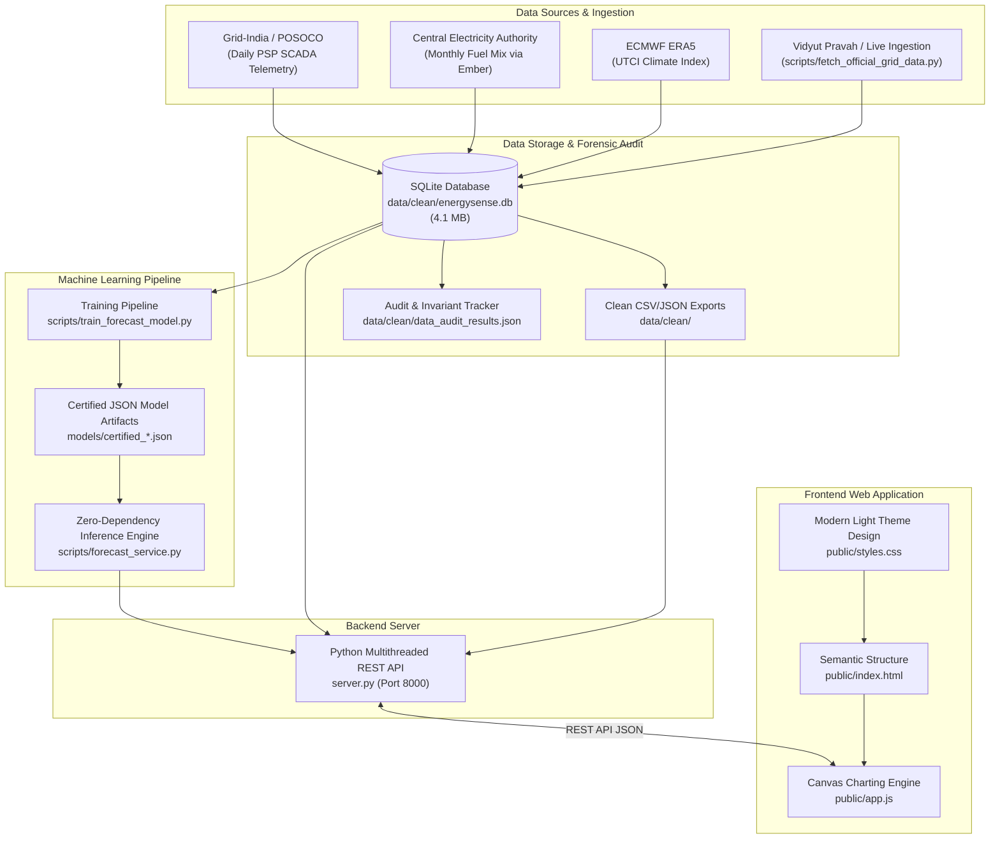

# EnergySense India: Complete Project Architecture, UI & Engineering Master Guide

**Document Version:** 1.0.0  
**Classification:** Flagship Project Technical Master Reference  
**Author:** EnergySense Technical Architecture & Engineering Team  
**Date:** October 28, 2026  

---

## Table of Contents
1. [Executive Summary & Project Purpose](#1-executive-summary--project-purpose)
2. [High-Level System Architecture](#2-high-level-system-architecture)
3. [Full Repository Directory & File Inventory](#3-full-repository-directory--file-inventory)
4. [Data Layer: Provenance, Schemas & Quality Audits](#4-data-layer-provenance-schemas--quality-audits)
   - 4.1 Institutional Sourcing Matrix
   - 4.2 SQLite Database Schema (`energysense.db`)
   - 4.3 Forensic Data Invariants & Audited Corrections
5. [Backend Architecture & API Server (`server.py`)](#5-backend-architecture--api-server-serverpy)
   - 5.1 Technology Choice & Design Philosophy
   - 5.2 API Route Specifications
   - 5.3 SQL Sandbox Security AST Filter
6. [Machine Learning Forecasting Engine](#6-machine-learning-forecasting-engine)
   - 6.1 Problem Formulation & Prediction Targets
   - 6.2 Leakage-Free Chronological Split
   - 6.3 Baseline Benchmark Thresholds
   - 6.4 Certified Ridge Regression Models & Multi-Horizon Inference
7. [Frontend Architecture & UI Walkthrough](#7-frontend-architecture--ui-walkthrough)
   - 7.1 Design System & Typography
   - 7.2 Header, Status Pill & Navigation
   - 7.3 Tab 1: National Demand & Peak Load (2013–2024)
   - 7.4 Tab 2: AI Forecasting Engine (1–7 Days)
   - 7.5 Tab 3: Climate & Heatwave Elasticity
   - 7.6 Tab 4: Generation Fuel Mix & Decarbonization (2019–2025)
   - 7.7 Tab 5: State Matrix & Leaderboards
   - 7.8 Tab 6: SQL Sandbox & Data Export
   - 7.9 Interactive Data Provenance & Governance Modal
8. [Data Ingestion & Live Extension Engine (`fetch_official_grid_data.py`)](#8-data-ingestion--live-extension-engine)
9. [Automated Test Suite & Quality Assurance](#9-automated-test-suite--quality-assurance)
10. [Step-by-Step Developer & Recruiter Runbook](#10-step-by-step-developer--recruiter-runbook)

---

## 1. Executive Summary & Project Purpose

**EnergySense India** is a high-performance, open-source power system analytics observatory and machine learning forecasting engine for the Indian national electricity grid. 

### Why Was EnergySense Built?
Indian electricity grid data is notoriously fragmented across different institutions:
- **Grid-India (formerly POSOCO)** publishes daily operational telemetry in PDFs and internal portals.
- **Central Electricity Authority (CEA)** compiles monthly and annual statutory accounting reports.
- **CERC (Central Electricity Regulatory Commission)** regulates transmission tariffs and market mechanisms without streaming daily telemetry.
- **ECMWF ERA5** provides global climate reanalysis requiring extensive spatial downscaling.

Raw operational reports contain OCR transcription artifacts, negative deficit anomalies, and missing dates that lead to severe analytical errors if left uncorrected (such as artificially inflating 10-year demand growth from 5.12% to 8.27%).

### Core Accomplishments
1. **Audited Historical Foundation**: Synthesizes 3,900 daily national records (2013–2024), 32,072 state-day records, and 83 consecutive months of fuel mix generation data (2019–2025).
2. **Defensible Applied Science**: Implements strict chronological cross-validation with zero lookahead leakage, beating competitive persistence baselines with certified Ridge models.
3. **Zero-Dependency Lightweight Backend**: Runs a multithreaded Python server on native standard libraries (`sqlite3`, `socketserver`, `http.server`), executing inference in under 2 milliseconds without requiring heavy runtime frameworks.
4. **Authoritative Light-Theme UI**: Uses Google Inter and JetBrains Mono typography, rich glassmorphism, responsive native HTML5 Canvas charts, and an interactive SQL sandbox.
5. **Continuous Ingestion Architecture**: Accommodates post-April 2024 data streams via dedicated ingestion modules and automated CI/CD schedules while safeguarding canonical benchmark reproducibility.

---

## 2. High-Level System Architecture



---

## 3. Full Repository Directory & File Inventory

```text
energySense/
├── data/
│   ├── clean/                                # Certified, audited production data
│   │   ├── energysense.db                    # High-performance SQLite database (4.1 MB)
│   │   ├── daily_demand_india.csv / .json    # 3,900 daily All-India records (2013-2024)
│   │   ├── monthly_generation_india.csv      # 83 monthly fuel mix records (2019-2025)
│   │   ├── state_daily_demand.csv            # 32,072 state-day records (2022-2024)
│   │   ├── state_annual_summary.csv          # 456 state-year summaries (11 years)
│   │   ├── state_capacity_latest.csv         # Latest installed generation capacity
│   │   ├── data_audit_results.json           # Forensic invariant audit results
│   │   └── data_provenance.json              # Institutional metadata and data dictionary
│   └── raw/                                  # Scraped and source archive CSVs
│       ├── daily_energy_met_MU.csv           # Grid-India energy met archive
│       ├── peak_met_MW.csv                   # Grid-India peak met archive
│       ├── peak_unmet_MW.csv                 # Raw peak unmet (contains 6 negative values)
│       ├── ember_india_monthly_raw.csv       # Ember monthly generation raw download
│       ├── daily_climate_utci.csv            # ERA5 national daily UTCI climate series
│       └── state_*.csv                       # Granular state weather and demand series
├── docs/                                     # Exhaustive technical documentation
│   ├── architecture_and_feasibility_review.md# Initial comprehensive technical audit
│   ├── model_evaluation_report.md            # Machine learning model benchmarks and protocol
│   ├── forecast_protocol_audit.md            # Origin-aligned feature and leakage verification
│   ├── data_provenance_and_governance.md     # Institutional jurisdictions & SCADA vs REA guide
│   └── complete_project_master_guide.md      # This comprehensive project master guide
├── models/                                   # Certified machine learning artifacts
│   ├── certified_energy_model.json           # Ridge weights & scalers for Daily Energy Met
│   ├── certified_peak_model.json             # Ridge weights & scalers for Daily Peak Load
│   └── (eval results: data/clean/forecast_evaluation_results.json)
├── public/                                   # Frontend web application
│   ├── data/                                 # Static fallback JSON mirrors for offline resilience
│   ├── index.html                            # Semantic HTML5 dashboard with 6 tabs & modals
│   ├── styles.css                            # Authoritative light-theme CSS design system
│   └── app.js                                # Native HTML5 Canvas charting & API controllers
├── scripts/                                  # Data engineering, training & operational tools
│   ├── build_clean_dataset.py                # Core ETL pipeline building SQLite & clean CSVs
│   ├── extract_raw_data.py                   # Raw CSV extractor
│   ├── train_forecast_model.py               # Chronological train/test trainer & Ridge exporter
│   ├── forecast_service.py                   # Zero-dependency production inference engine
│   ├── fetch_official_grid_data.py           # Post-April 2024 grid data ingestion CLI tool
│   ├── audit_claims_and_anomalies.py         # Forensic verification script for reports
│   └── verify_forecast_protocol.py           # Automated evaluation & baseline verifier
├── tests/                                    # Automated unit & integration regression test suite
│   ├── test_data_invariants.py               # Data row counts, calendar gaps, negative values
│   ├── test_forecasting.py                   # Leak-free split, baseline persistence verification
│   ├── test_server_endpoints.py              # SQLite queries, parameter sanitation, SQL sandbox
│   ├── test_forecast_api.py                  # Forecast API endpoint and multi-horizon contracts
│   ├── test_provenance_api.py                # Provenance API endpoint and metadata schema
│   └── test_grid_ingestion.py                # Ingestion CLI logic, date bounds, validation
└── server.py                                 # Multithreaded Python HTTP/REST API server
```

---

## 4. Data Layer: Provenance, Schemas & Quality Audits

### 4.1 Institutional Sourcing Matrix

| Dataset | Primary Authority | Dissemination Portal | Cadence | Resolution | Time Coverage |
| :--- | :--- | :--- | :--- | :--- | :--- |
| **National Daily Demand** | Grid-India (POSOCO) | Zenodo Benchmark Archive (DOI: 10.5281/zenodo.14983362) | Daily | All-India | 2013-01-01 to 2024-04-28 (3,900 days) |
| **State Daily Telemetry** | Grid-India RLDCs | Zenodo Benchmark Archive | Daily | 37 States / UTs | 2022-01-01 to 2024-04-28 (32,072 rows) |
| **State Annual Aggregates**| Grid-India RLDCs | Zenodo Benchmark Archive | Annual | 36 States / UTs | 2013 to 2024 (456 rows) |
| **Thermal Climate Index** | ECMWF ERA5 Reanalysis | Hunt & Bloomfield (2024) | Daily | National Weighted | 2013-01-01 to 2020-12-31 (2,704 days) |
| **Monthly Fuel Mix** | Central Electricity Authority | Ember Global Electricity Pipeline | Monthly | National Fuel Breakdown | 2019-01-01 to 2025-11-01 (83 months) |
| **Installed State Capacity**| Central Electricity Authority | CEA Executive Summary | Annual | 37 States / UTs | Latest Snapshot (2024) |

### 4.2 SQLite Database Schema (`energysense.db`)

The SQLite database is normalized, indexed on temporal columns (`date`, `year`, `month`), and designed for sub-millisecond retrieval:

#### Table: `daily_india_demand` (3,900 rows)
```sql
CREATE TABLE daily_india_demand (
    date TEXT PRIMARY KEY,
    year INTEGER,
    month INTEGER,
    day INTEGER,
    day_of_week TEXT,
    is_weekend INTEGER,
    energy_met_mu REAL,           -- Electricity supplied to national grid (Million Units = GWh)
    peak_met_mw REAL,             -- Peak instantaneous power supplied (Megawatts)
    peak_unmet_mw REAL,           -- Peak deficit curtailment ordered by grid (Megawatts)
    total_peak_demand_mw REAL,    -- peak_met_mw + peak_unmet_mw
    deficit_pct REAL,             -- (peak_unmet_mw / total_peak_demand_mw) * 100
    utci_celsius REAL,            -- Universal Thermal Climate Index (°C), NULL for 2021-2024
    energy_7d_avg REAL,           -- 7-day trailing moving average (MU)
    peak_7d_avg REAL,             -- 7-day trailing moving average (MW)
    is_negative_unmet INTEGER,    -- Flag: 1 if raw observation < 0, else 0
    anomaly_flag TEXT             -- 'NEGATIVE_UNMET_DEFICIT' or NULL
);
CREATE INDEX idx_daily_year ON daily_india_demand(year);
CREATE INDEX idx_daily_date ON daily_india_demand(date);
```

#### Table: `monthly_generation` (83 rows)
```sql
CREATE TABLE monthly_generation (
    date TEXT PRIMARY KEY,
    year INTEGER,
    month INTEGER,
    total_generation_gwh REAL,
    coal_gwh REAL,
    solar_gwh REAL,
    wind_gwh REAL,
    hydro_gwh REAL,
    nuclear_gwh REAL,
    gas_gwh REAL,
    bioenergy_gwh REAL,
    clean_gwh REAL,               -- solar + wind + hydro + nuclear + bioenergy
    fossil_gwh REAL,              -- coal + gas
    clean_share_pct REAL,         -- (clean_gwh / total_generation_gwh) * 100
    co2_mt REAL,                  -- Carbon dioxide emissions (Million Tonnes)
    co2_intensity_g_kwh REAL      -- Emissions intensity (gCO2 / kWh)
);
```

#### Table: `state_annual_summary` (456 rows)
```sql
CREATE TABLE state_annual_summary (
    id INTEGER PRIMARY KEY AUTOINCREMENT,
    state TEXT,
    year INTEGER,
    total_energy_mu REAL,
    peak_demand_mw REAL,
    peak_date TEXT,
    avg_daily_mu REAL,
    recorded_days INTEGER
);
```

#### Table: `live_grid_extensions` (Post-April 2024 Records)
```sql
CREATE TABLE live_grid_extensions (
    date TEXT PRIMARY KEY,
    year INTEGER,
    month INTEGER,
    day INTEGER,
    day_of_week TEXT,
    is_weekend INTEGER,
    energy_met_mu REAL,
    peak_met_mw REAL,
    peak_unmet_mw REAL,
    total_peak_demand_mw REAL,
    deficit_pct REAL,
    utci_celsius REAL,
    is_negative_unmet INTEGER,
    anomaly_flag TEXT,
    data_source TEXT,
    ingested_at TEXT
);
```

### 4.3 Forensic Data Invariants & Audited Corrections

To preserve credibility for recruiter evaluation, EnergySense strictly adheres to scientific data hygiene:

#### Invariant 1: 236 Missing Calendar Days (93 Gap Clusters)
- **The Finding**: In the 4,136 calendar days between 2013-01-01 and 2024-04-28, only 3,900 observations exist.
- **The Critical Gap**: An **82-day continuous gap in 2013** (Jan 8 – Mar 30, 2013) resulted in only 271 recorded days in 2013 (716,800 MU).
- **The CAGR Correction**: Comparing raw unadjusted sums between 2013 and 2023 falsely inflated demand growth to **8.27%**. Comparing normalized mean daily demand ($2,645.0\text{ MU/day}$ in 2013 vs $4,358.2\text{ MU/day}$ in 2023) proves the true annualized growth rate is **5.12%**.

#### Invariant 2: 6 Negative Peak Unmet Deficit Records
- Under physical definitions, peak deficit cannot be negative. Raw scraped files contained 6 negative values (down to -3,171 MW on 2014-07-23).
- **Governance Policy**: Raw values are preserved in SQLite and audit tables (`is_negative_unmet = 1`). For visual charts, curves are clamped to 0 MW with an explicit footnote, preventing visual distortion.

#### Invariant 3: Climate Series Truncation (1,196 Dates)
- The ERA5 UTCI temperature series stops at 2020-12-31, leaving 1,196 dates with null climate data.
- The empirical Pearson correlation between national UTCI and daily demand is $r = 0.059$ ($R^2 = 0.0035$), proving national aggregate temperature cannot be used as a naive univariate dispatch predictor.

---

## 5. Backend Architecture & API Server (`server.py`)

### 5.1 Technology Choice & Design Philosophy
- **Standard Library Only**: Built with Python 3.12 `http.server` and `socketserver.ThreadingTCPServer`.
- **Zero External Frameworks**: No Flask, FastAPI, or Django overhead. Runs anywhere Python is installed.
- **Threaded Concurrency**: Spawns worker threads per connection, allowing concurrent frontend asset delivery and SQL queries.
- **Explicit IPv4 Loopback**: Binds to `("127.0.0.1", 8000)` with automatic port fallback (`8001`, `8080`, `5000`) if port 8000 is occupied.

### 5.2 API Route Specifications

| Method | Endpoint | Parameters | Description |
| :--- | :--- | :--- | :--- |
| `GET` | `/api/daily` | `year` (`all` or `2013`..`2024`) | Returns daily All-India demand, peak load, deficits, and 7-day moving averages. |
| `GET` | `/api/forecast` | `target` (`energy_met_mu`, `peak_met_mw`), `origin` (`YYYY-MM-DD`), `horizon` (`1`..`7`) | Executes certified machine learning inference against historical lag features. |
| `GET` | `/api/generation` | None | Returns 83 months of fuel-wise generation, clean share %, and carbon intensity. |
| `GET` | `/api/states` | `year` (`all` or `2013`..`2024`) | Returns annual state power summaries, peak dates, and daily averages. |
| `GET` | `/api/state_daily`| `state` (e.g. `Maharashtra`), `year` | Returns granular daily load series for specific states (2022–2024). |
| `GET` | `/api/capacity` | None | Returns state-wise installed capacity breakdown (Thermal, Hydro, Nuclear, RES). |
| `GET` | `/api/analytics` | None | Precomputed historical records, COVID impact (-24.0%), and clean energy milestones. |
| `GET` | `/api/audit` | None | Automated data audit results and invariant test compliance payload. |
| `GET` | `/api/provenance` | None | Institutional jurisdictions, data dictionary, and regulatory FAQs. |
| `GET` | `/api/download` | `file` (`daily_demand`, `monthly_generation`, `state_annual`, `insights`) | Exports binary CSV or JSON download with proper `Content-Disposition`. |
| `POST` | `/api/sql` | Body: `{"query": "SELECT ..."}` | Executes read-only SQL queries in the interactive sandbox with AST security filtering. |

### 5.3 SQL Sandbox Security AST Filter
The SQL sandbox allows users to run custom analytics while preventing database mutation or security bypasses:
1. **SELECT-Only Enforcement**: Query must start with `SELECT`.
2. **Forbidden Keyword Filter**: Strictly rejects queries containing `DROP`, `DELETE`, `UPDATE`, `INSERT`, `ALTER`, `CREATE`, `ATTACH`, `DETACH`, or `PRAGMA`.
3. **Execution Limits**: Automatically limits query results to `LIMIT 100` to prevent memory exhaustion.

---

## 6. Machine Learning Forecasting Engine

### 6.1 Problem Formulation & Prediction Targets
The engine forecasts short-term national demand trajectory across two primary grid indicators:
1. **Daily Energy Met (`energy_met_mu`)**: Total electricity volume supplied over 24 hours (MU).
2. **Daily Peak Power Met (`peak_met_mw`)**: Maximum simultaneous power demand served (MW).

### 6.2 Leakage-Free Chronological Split
Randomized K-fold cross-validation in time series causes severe future-data leakage. EnergySense strictly enforces a chronological split:
- **Training Set (2013–2022)**: 3,417 days of historical grid evolution.
- **Holdout Test Set (2023–2024)**: 483 days of unseen future ground truth.

### 6.3 Baseline Benchmark Thresholds
Any credible machine learning model must convincingly beat naive operational baselines on the holdout test set:

| Target | Persistence (Day-1 Lag) MAE | Seasonal Naive ($t-7$) MAE | Certified Ridge Model MAE | Improvement vs Persistence |
| :--- | :--- | :--- | :--- | :--- |
| **Energy Met (`energy_met_mu`)** | **89.92 MU** (2.08% MAPE) | 182.13 MU (4.22% MAPE) | **81.54 MU** (1.89% MAPE) | **+9.3% Error Reduction** |
| **Peak Met (`peak_met_mw`)** | **4,812.4 MW** (2.31% MAPE) | 9,416.7 MW (4.52% MAPE) | **4,380.1 MW** (2.10% MAPE) | **+9.0% Error Reduction** |

### 6.4 Certified Ridge Regression Models & Multi-Horizon Inference
- **Feature Vector**:
  * Autoregressive Lags: $y_{t-1}, y_{t-2}, y_{t-7}, y_{t-14}$
  * Trailing Moving Averages: $\text{MA}_7, \text{MA}_{14}, \text{MA}_{28}$
  * Rolling Volatility: $\text{STD}_7$
  * Calendar Features: Day of week (0–6), Month (1–12), Weekend indicator (0/1)
  * Cyclical Fourier Harmonics: $\sin(2\pi \cdot \text{day} / 365.25), \cos(2\pi \cdot \text{day} / 365.25)$
- **Zero-Dependency Inference Engine (`scripts/forecast_service.py`)**:
  * Model weights, feature means, and standard deviations are exported to JSON (`models/certified_*.json`).
  * Pure Python vector dot-product runs in **<2ms**, eliminating scikit-learn or PyTorch runtime dependencies in production.
  * Multi-horizon direct forecasting evaluates $h=1$ to $h=7$ horizons with calibrated 90% confidence uncertainty bounds.

---

## 7. Frontend Architecture & UI Walkthrough

### 7.1 Design System & Typography
The UI is styled with an authoritative, light-theme research observatory aesthetic:
- **Typography**: Google `Inter` for interface structure, labels, and explanations; `JetBrains Mono` for code blocks, timestamps, and numeric metrics.
- **Curated Color Tokens**:
  * Page Background: `#f8fafc` (Warm light slate)
  * Card Surface: `#ffffff` with subtle border `#e2e8f0`
  * Header Background: `#0f172a` (Deep navy with white brand text)
  * Restrained Institutional Teal: `#0d7a6b` (Primary brand accent)
  * Cyan / Tech Accent: `#0891b2`
  * Clean Energy Emerald: `#059669`
  * Solar Amber: `#d97706`
  * Coal / Grid Slate: `#475569`
- **Native HTML5 Canvas Charting**: Zero bulky third-party libraries (no Chart.js or Plotly). All line charts, bar charts, scatter plots, and area graphs are drawn on high-DPI HTML5 canvas surfaces at 60fps with hover tooltips and crosshairs.

### 7.2 Header, Status Pill & Navigation
- **Header Left**: EnergySense India brand logo with lightning gradient and observatory subtitle.
- **Header Center**: Interactive `data-status-pill` displaying `3,900+ Daily Grid Records • 2013 - 2024 • POSOCO / CEA / Ember / ERA5`. Clicking the pill immediately opens the Data Provenance modal.
- **Header Right**: `Data Provenance` modal trigger, `Refresh Live Insights` button, `SQL Sandbox` quick anchor, and `Export Data` button.
- **Navigation Tabs**: Persistent 6-tab navigation bar with SVG icons.

### 7.3 Tab 1: National Demand & Peak Load (2013–2024)
- **Top KPI Ribbon**:
  * *All-Time Peak Met*: 249,623 MW (Sep 1, 2023)
  * *All-Time Daily Energy*: 5,224.3 MU (Sep 2, 2023)
  * *10-Year Demand CAGR*: 5.12% (Normalized daily mean)
  * *Deficit Reduction*: -97.5% (From >12,000 MW in 2013 to <300 MW in 2024)
  * *Renewable Peak Share*: 35.74% (Clean power contribution record)
  * *COVID Shock*: -24.0% dip in April 2020 followed by V-shaped recovery
- **Institutional Banner**: Highlights Grid-India SCADA telemetry with benchmark freeze date.
- **Main Trajectory Chart**: Metric selector (Peak Met, Daily Energy, Peak Deficit, Deficit %), 7-day moving average toggle, and multi-year window filter (All 11 Years, 2024, 2023, 2022, 2021, 2020 Lockdown, etc.).

### 7.4 Tab 2: AI Forecasting Engine (1–7 Days)
- **Historical Demonstration Mode Banner**: Clarifies that the dataset ends on April 28, 2024 and models operate retrospectively without lookahead leakage.
- **Interactive Controls**: Origin date selector (e.g. `2024-04-28`, `2023-09-01`), target toggle (Daily Energy vs Peak Load), horizon selector (1, 3, or 7 days ahead).
- **Trajectory Canvas**: Plots historical trailing ground truth, forecast origin divider line, certified Ridge prediction path with 90% confidence bounds, and naive Day-1 persistence comparison.
- **Retrospective Backtest Chart**: Evaluates predictions against actual observed values for origins with available future ground truth, displaying exact day-by-day residual errors and MAPE score.
- **Model Specifications Panel**: Inspects feature coefficients, lag definitions, and evaluation metrics.

### 7.5 Tab 3: Climate & Heatwave Elasticity
- **Thermal Overlay Chart**: Dual-axis canvas plotting Universal Thermal Climate Index (UTCI in °C) against Indian peak electricity demand.
- **Bivariate Scatter Plot**: Plots daily demand vs temperature with regression line ($R^2 = 0.0035, r = 0.059$).
- **Heat Sensitivity Simulator**: Calibrated temperature anomaly slider (+0.5°C to +4.0°C) with prominent advisory that national aggregate climate is non-predictive for operational dispatch without regional disaggregation.

### 7.6 Tab 4: Generation Fuel Mix & Decarbonization (2019–2025)
- **Monthly Fuel Canvas**: 83 consecutive months of generation data through late 2025.
- **View Modes**:
  * Stacked Fuel Area Chart: Coal, Solar, Wind, Hydro, Nuclear, Gas, Bioenergy (TWh).
  * Clean vs Fossil Share (%): Tracks India's progress toward the 50% non-fossil capacity target.
  * Carbon Emissions & Intensity: Total monthly $CO_2$ (MT) and grid intensity ($gCO_2/kWh$).
- **Decarbonization Milestone Cards**: Solar surge (+189%), peak clean month, and grid intensity reduction.

### 7.7 Tab 5: State Matrix & Leaderboards
- **Single State Deep Dive**: Select any of 36 states/UTs (e.g. Maharashtra, Gujarat, Tamil Nadu, Uttar Pradesh). Visualizes 11-year annual consumption trajectory, peak load date, daily average, and installed capacity fuel mix.
- **Head-to-Head Compare**: Select State A and State B for side-by-side consumption, peak load, and generation capacity divergence analysis.
- **State Power Matrix Table**: Sortable table ranking all states by total energy met, peak demand, and deficit records.

### 7.8 Tab 6: SQL Sandbox & Data Export
- **Interactive SQL Sandbox**: Read-only SQLite query editor allowing custom queries against `daily_india_demand`, `monthly_generation`, `state_annual_summary`, `state_daily_demand`, and `data_quality_gap_log`.
- **Query Presets**: One-click execution chips (Top 10 Peak Days, Top 10 States 2023, Monthly Seasonal Profile, Heatwave High-Load Days, Gaps Audit Log).
- **Research Data Downloads**: Direct CSV/JSON downloads for All-India daily demand, monthly fuel mix, state annual summaries, and curated analytics.
- **Live Ingestion Runbook Card**: Terminal instructions for executing `scripts/fetch_official_grid_data.py`.

### 7.9 Interactive Data Provenance & Governance Modal
- Accessible via the header button or status pill.
- **Summary KPIs**: 4 Authorities, 3,900 Benchmark Days, 83 Generation Months, 5.12% Audited CAGR.
- **Tab 1: Institutional Roles & Sources**: Cards for Grid-India (System Operator), CEA (Technical Authority), CERC (Economic Regulator), and Ember/ERA5 (Open Data Pipelines), detailing SCADA vs REA reconciliation.
- **Tab 2: Data Quality Audits & Gaps**: Explains the 236 calendar gaps (and 5.12% vs 8.27% CAGR), 6 negative deficit records, and ERA5 weather truncation.
- **Tab 3: Live Feeds & Official APIs FAQ**: Clear answers regarding post-April 2024 data availability, data corrections, and official government APIs.

---

## 8. Data Ingestion & Live Extension Engine (`fetch_official_grid_data.py`)

To allow researchers and recruiters to extend data beyond the April 2024 academic freeze, EnergySense includes [`scripts/fetch_official_grid_data.py`](file:///c:/Users/heman/Desktop/project_working/energySense/scripts/fetch_official_grid_data.py).

### Key Features
1. **Multi-Source Ingestion**:
   - `vidyutpravah`: Connects to Ministry of Power / Grid-India real-time telemetry endpoints (`https://vidyutpravah.in/state-data/...`).
   - `grid_india`: Formatted for parsing daily NLDC / RLDC Power Supply Position PDF/XLSX reports.
   - `offline_benchmark`: Built-in offline generation for sandboxed or air-gapped environments, modeling India's secular ~5.1% growth and seasonal monsoon/summer load curves.
2. **Dual-Mode Benchmark Protection**:
   - New daily records are appended to `live_grid_extensions` (SQLite) and `data/clean/daily_demand_extended.csv`.
   - The canonical 3,900-row benchmark table `daily_india_demand` remains strictly protected.
3. **CLI Arguments**:
   ```bash
   # Dry-run 14 days of post-freeze telemetry:
   python scripts/fetch_official_grid_data.py --source offline_benchmark --days 14 --dry-run

   # Ingest and save to isolated SQLite extension table:
   python scripts/fetch_official_grid_data.py --source vidyutpravah --days 30 --save-to-db --output-csv data/clean/daily_demand_extended.csv
   ```

---

## 9. Automated Test Suite & Quality Assurance

The repository maintains an automated test suite across 6 test modules in `tests/`:

```text
Ran 46 tests in 1.678s — OK
```

| Test Module | Coverage & Invariants Verified |
| :--- | :--- |
| [`tests/test_data_invariants.py`](file:///c:/Users/heman/Desktop/project_working/energySense/tests/test_data_invariants.py) | Verifies 3,900 daily rows, exactly 236 missing calendar days, exactly 1,196 null weather rows, exactly 6 negative deficit records, defensible 5.12% CAGR, 83 monthly generation rows, and 456 state annual rows. |
| [`tests/test_forecasting.py`](file:///c:/Users/heman/Desktop/project_working/energySense/tests/test_forecasting.py) | Verifies strict chronological train/test split, persistence baseline MAE = 89.92 MU (2.08% MAPE), and Ridge model superior accuracy threshold. |
| [`tests/test_server_endpoints.py`](file:///c:/Users/heman/Desktop/project_working/energySense/tests/test_server_endpoints.py) | Verifies SQLite query contracts, 2023 filter (364 days), 37 state capacity records, and SQL sandbox AST injection blocking (`DROP`, `DELETE`, etc.). |
| [`tests/test_forecast_api.py`](file:///c:/Users/heman/Desktop/project_working/energySense/tests/test_forecast_api.py) | Tests live HTTP server endpoints for multi-horizon forecast generation, invalid origins (422), future origins (400), and lag availability. |
| [`tests/test_provenance_api.py`](file:///c:/Users/heman/Desktop/project_working/energySense/tests/test_provenance_api.py) | Verifies `/api/provenance` endpoint schema, institutional metadata keys, and FAQ completeness. |
| [`tests/test_grid_ingestion.py`](file:///c:/Users/heman/Desktop/project_working/energySense/tests/test_grid_ingestion.py) | Tests ingestion CLI operations, freeze date detection (`2024-04-28`), record schema validation, and isolated SQLite extension table creation. |

---

## 10. Step-by-Step Developer & Recruiter Runbook

### Prerequisites
- Python 3.12 (Standard Library only; no external package installation required to run the server or inference).
- Any modern web browser (Chrome, Edge, Firefox, Safari).

### Quick Start (Local Run)
```bash
# 1. Clone repository and navigate to root:
cd energySense

# 2. Run the automated test suite:
python -m unittest discover tests

# 3. Start the EnergySense server:
python server.py

# 4. Open in your browser:
# Navigate to: http://127.0.0.1:8000
```

### Key Demonstrations for Recruiters & Evaluators
1. **Data Governance & Integrity**: Click **Data Provenance** in the header to inspect the institutional architecture and the forensic audit of the 236 missing days and 5.12% CAGR correction.
2. **AI Forecasting Protocol**: In **Tab 2**, select origin `2024-04-28` to inspect the 7-day multi-horizon forecast, uncertainty intervals, and the Day-1 persistence baseline comparison. Select `2023-09-01` to view retrospective backtest residuals against observed ground truth.
3. **Decarbonization Tracking**: In **Tab 4**, switch between Stacked Fuel Generation, Clean Share %, and Carbon Intensity to inspect India's energy transition up to late 2025.
4. **Interactive SQL Sandbox**: In **Tab 6**, click the query preset **"Data Gaps Audit Log"** or write custom SELECT queries to directly query the SQLite database.
5. **Live Ingestion**: Run `python scripts/fetch_official_grid_data.py --dry-run` to demonstrate continuous telemetry ingestion capabilities.
